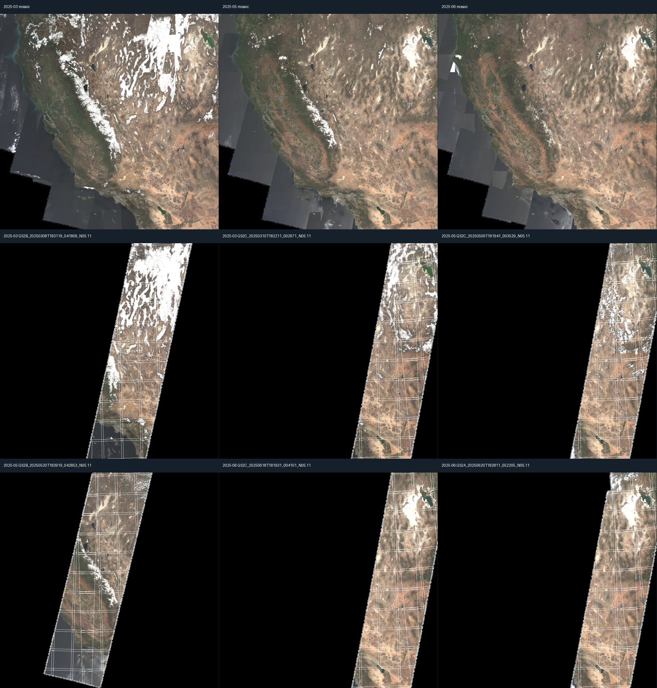

# Southwest seasonal imagery spike

Flat assets only; Slidev can handle the later rotation and time stack. Nothing in this spike edits the deck.



## Assets

- `mosaic-2025-{03,05,06}.png`: three monthly RGB mosaics on a shared EPSG:3310 grid, with transparent nodata.
- `datatake-2025-MM-{1,2}.png`: two selected real acquisition/datake groups per month, reprojected to the same grid, transparent outside the pass footprint. Thin white outlines show source STAC granule footprints. The files stay flat, with labels/IDs kept separately in `results.json`.
- `contact-sheet.png`: flat review sheet of the three monthly mosaics.
- `manifest.json`: concise provenance, decisions, selected pass IDs and output listing. `results.json` records queried catalog CRS distribution, grid dimensions, selected item IDs and pass details.

## Reproduce

```sh
uv run python slides/foss4gna-2026/spikes/southwest-images/reproduce.py
```

The script reuses the locally cached STAC GeoParquet index at `.cache/southwest-images/southwest-2025.parquet`, creating it from public Earth Search if absent. It uses public HTTPS with `obstore.HTTPStore` rooted at the existing S3 virtual-host hostname. For example, `https://e84-earth-search-sentinel-data.s3.us-west-2.amazonaws.com/<key>` maps to HTTPStore root `https://e84-earth-search-sentinel-data.s3.us-west-2.amazonaws.com` plus the unchanged `<key>` path. An unauthenticated header and bounded window read succeeded. No AWS credentials/metadata discovery is used.

## Data and interpretation

Based on `docs/notebooks/demo_southwest_monthly.ipynb`: Earth Search `sentinel-2-c1-l2a`, 2025 spring, bbox `(-444000, -609000, 681000, 500000)` in EPSG:3310; RGB assets; scene filter `eo:cloud_cover < 50`; ascending cloud-cover ordering; first-valid mosaic. This is scene-level cloud ranking, not pixel-level cloud masking.

The notebook's grid is 300 m. For this bounded visual spike, all flat output images use the same coarsened 1200 m grid (938 x 924), EPSG:3310, same extent and affine transform. Fixed display stretch: source RGB DN 0–5000 mapped linearly to 0–255; alpha is transparent where all bands are nodata. Inspecting the contact sheet, March retains substantially more Sierra Nevada snow than May/June, while the latter two show the warmer, snow-reduced landscape. March/May/June were selected to show that visible spring-to-early-summer contrast; coverage and cloud gaps remain visible.

For orbit ingredients, `s2:datatake_id` is the verified grouping field. The two datatakes with the most qualifying catalog granules are shown for each selected month. These are pass-level collections of multiple Sentinel-2 granule tiles, not single tiles mislabeled as swaths. The six layers contain 60–68 qualifying granules each; they are a deliberately limited sample of all monthly datatakes. Outlines use the items' WGS84 geometries projected to EPSG:3310. Each pass image is first-valid mosaicked in the same cloud-ranked source order, so overlaps within a datatake are not individually visible as duplicate pixel layers. The separate pass images make overlap between different acquisitions revealable; combine/toggle them in the final animation as needed.

The source mosaic is built at 1200 m, not the notebook's 300 m; it is for visual review, not analysis. Transparent nodata may display black in viewers that do not composite alpha. Read selected dates, datatake IDs, item lists, output paths and source CRS counts in `results.json` / `manifest.json`.
